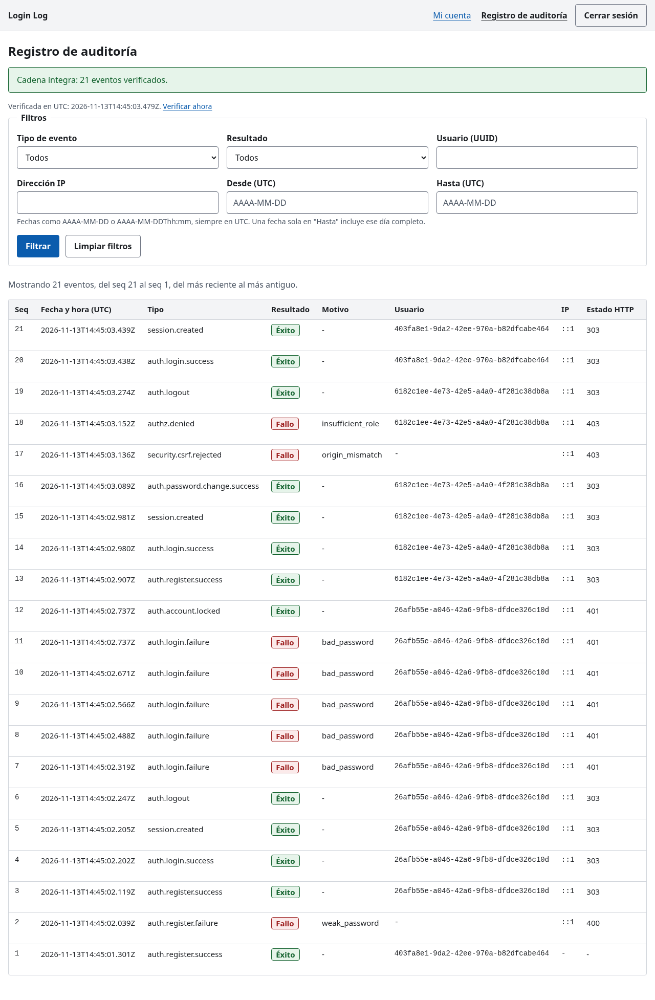
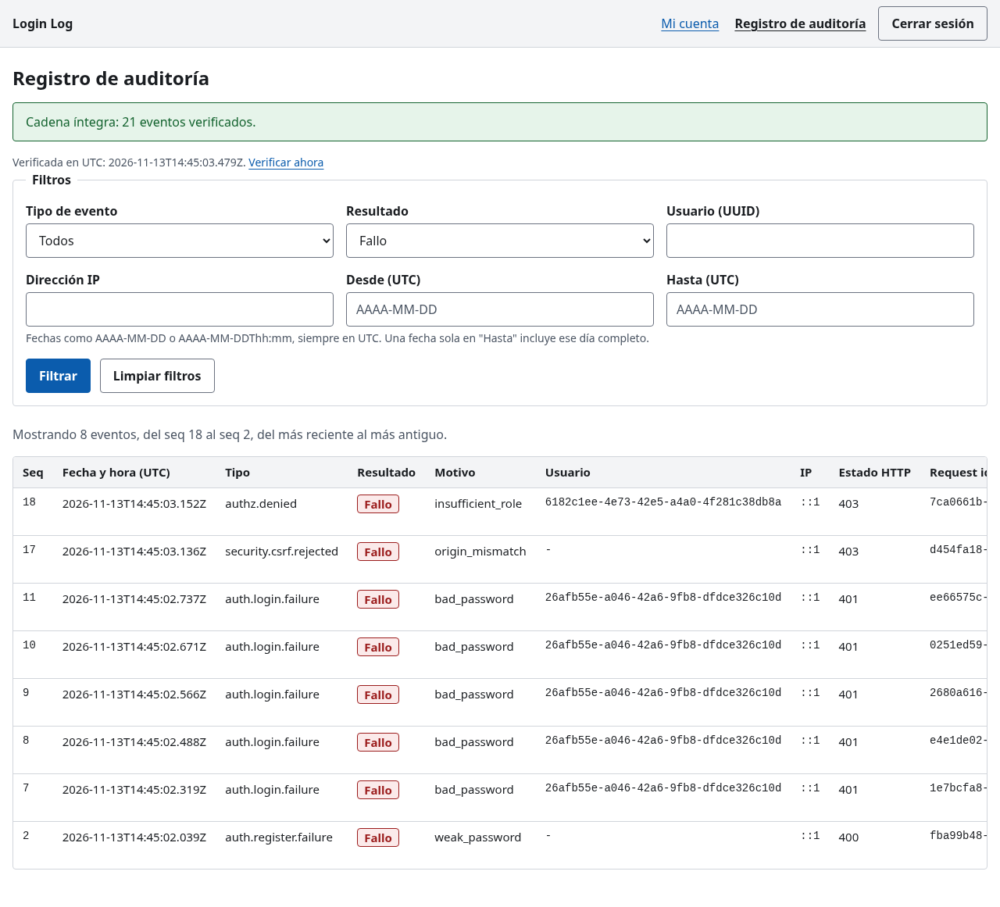
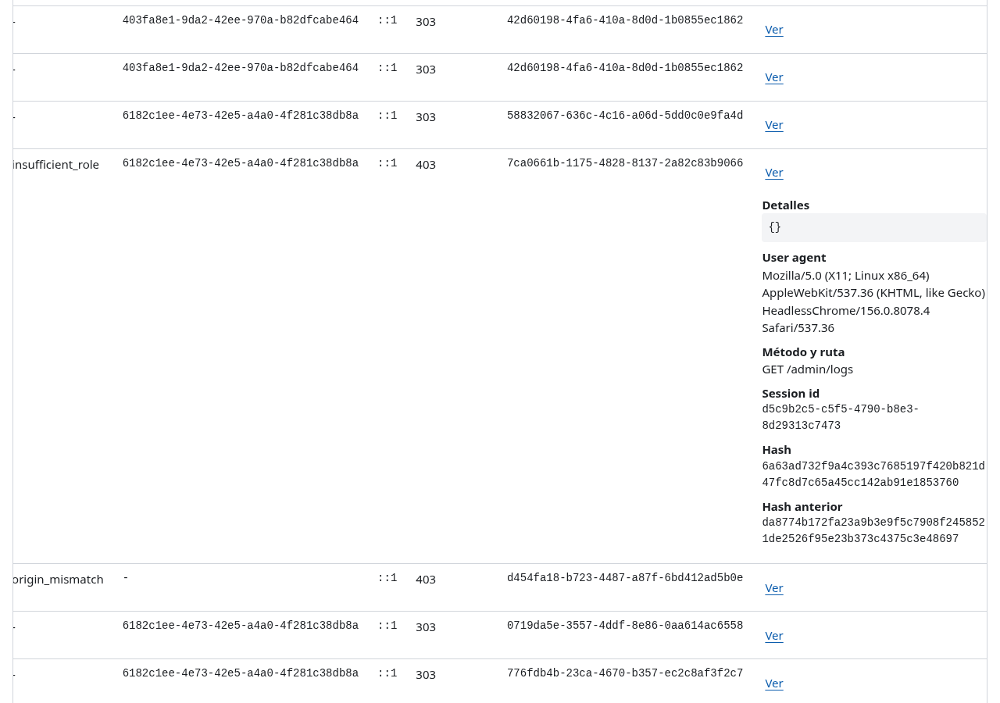
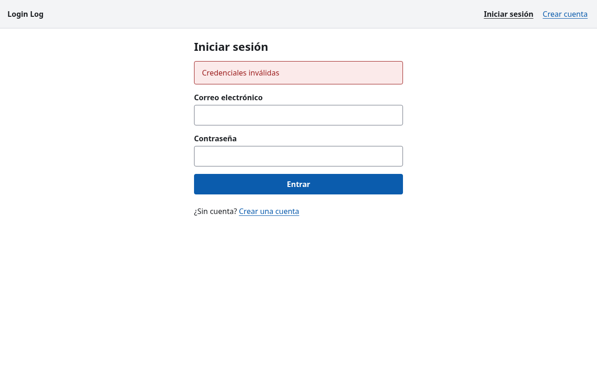
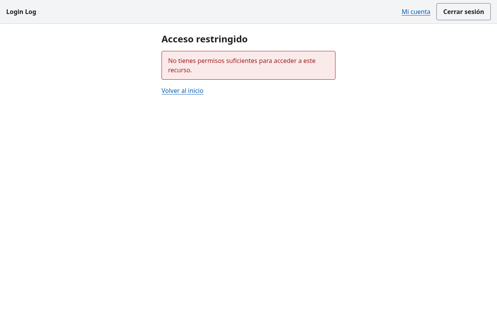
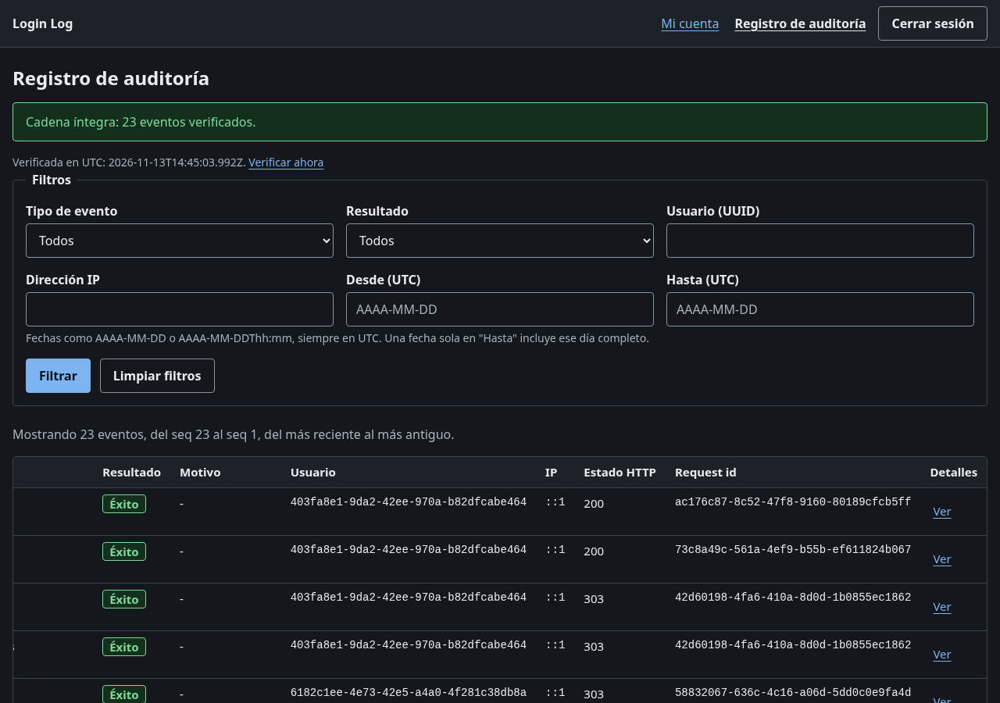
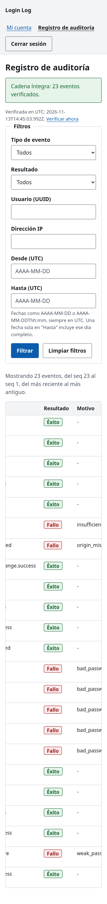

# Login_Log

Login básico cuyo producto principal es el registro de auditoría de autenticación. Toma como referencia las recomendaciones de OWASP Logging Cheat Sheet y el requisito 10 de PCI DSS, sin afirmar cumplimiento formal ni certificación alguna.

## 1. Qué es

Login_Log es una aplicación web centrada en registrar de forma estructurada los eventos del ciclo de vida de la autenticación y las sesiones de usuario. La tabla de auditoría en la base de datos es de solo inserción para el rol de la aplicación y cada fila se enlaza mediante una cadena criptográfica de hashes SHA-256 calculada por un trigger en PostgreSQL, lo que hace detectable cualquier alteración posterior de los registros. Paralelamente, los eventos se escriben en archivos de log en formato JSONL siguiendo el estándar Elastic Common Schema (ECS 8.11.0).

## 2. El registro en imágenes

Las capturas siguientes provienen de una ejecución de demostración sobre la base de datos de desarrollo local con cuentas `@example.com` y origen IP `::1`. Para regenerarlas con la aplicación en ejecución (`npm run dev`) y un usuario administrador creado previamente (`npm run seed:admin`), se ejecuta el guion `scripts/capturas.mjs` definiendo las cuatro variables de entorno requeridas:

```bash
ADMIN_EMAIL=<correo_admin> ADMIN_PASSWORD=<clave_admin> DEMO_PASSWORD=<clave_demo_1> DEMO_PASSWORD_2=<clave_demo_2> node scripts/capturas.mjs
```

### Vista general del visor de auditoría



Muestra `/admin/logs` a 1280 píxeles de ancho y página completa, con el aviso `Cadena íntegra: 21 eventos verificados` y la tabla de secuencias 21 a 1 (`Seq`, `Fecha y hora (UTC)`, `Tipo`, `Resultado`, `Motivo`, `Usuario`, `IP`, `Estado HTTP`). En la secuencia aparecen el rechazo de alta `auth.register.failure` por `weak_password` (400), el registro exitoso, el inicio de sesión con `session.created`, el cierre de sesión, cinco `auth.login.failure` por `bad_password` (401) seguidos de `auth.account.locked`, el cambio de contraseña `auth.password.change.success`, el rechazo `security.csrf.rejected` por `origin_mismatch` (403) registrado sin usuario y la denegación `authz.denied` por `insufficient_role` (403).

### Filtro por eventos de fallo



Muestra el mismo visor con el filtro `Resultado = Fallo` (`outcome=failure`), que reduce el listado a los 8 eventos fallidos ocurridos entre las secuencias 18 y 2. Cada fila conserva su número de secuencia original dentro de la cadena y permite inspeccionar por separado los rechazos de registro, autenticación, CSRF y autorización.

### Detalle expandido de un evento



Muestra la fila `authz.denied` (`seq` 18) con su panel de detalle desplegado: `Detalles` (`{}`), `User agent`, `Método y ruta` (`GET /admin/logs`), `Session id`, `Hash`, `Hash anterior` y la columna `Request id`. Demuestra que cada registro vincula los metadatos HTTP de la petición con el hash SHA-256 propio y el hash del evento inmediatamente anterior.

### Aviso de error en inicio de sesión



Muestra la pantalla `/login` con el aviso `Credenciales inválidas` (HTTP 401) tras enviar una contraseña incorrecta. El mensaje presentado al cliente no distingue entre un correo inexistente, una contraseña errónea o una cuenta bloqueada, mientras que el registro de auditoría almacena el motivo específico en la columna `reason`.

### Acceso restringido al visor de administración



Muestra la pantalla `Acceso restringido` (HTTP 403) que recibe un usuario autenticado sin rol `admin` al solicitar `GET /admin/logs`. El rechazo queda registrado en la cadena como `authz.denied` con motivo `insufficient_role`, conservando el `user_id` y el `session_id` de la sesión activa.

### Tema oscuro y vista móvil





Muestran el visor `/admin/logs` con esquema de color oscuro (`prefers-color-scheme: dark`, 1280x900 píxeles) y en ancho móvil de 320 píxeles a página completa. En ambos formatos se mantienen visibles el aviso de verificación de la cadena, los controles de filtrado y la tabla de eventos.

## 3. Requisitos y puesta en marcha paso a paso

### Requisitos

- Node.js 22 (probado con Node 22.12 o superior)
- PostgreSQL (probado con PostgreSQL 18)

### Roles de base de datos

El sistema utiliza dos roles diferenciados de PostgreSQL:

- Rol dueño o administrativo (`postgres` u otro superusuario local): se usa exclusivamente para ejecutar las migraciones mediante `MIGRATION_DATABASE_URL` (y `TEST_MIGRATION_DATABASE_URL`), y para ejecutar el script `seed:admin`. Crea la base de datos si no existe, crea tablas, índices, funciones, triggers y roles, y sincroniza la contraseña del rol de la aplicación enviándola convertida en un verificador SCRAM-SHA-256, sin exponer la contraseña en claro en las sentencias SQL.
- Rol restringido de la aplicación (`login_log_app`): es el usuario con el que corre el servidor en tiempo de ejecución (`DATABASE_URL`). Solo tiene permisos de `USAGE` sobre el esquema `public`, `SELECT, INSERT, UPDATE, DELETE` en `sessions`, y estrictamente `SELECT, INSERT` en `auth_events`. En la tabla `users`, tras la migración 005, tiene revocado `DELETE` y `UPDATE` general: únicamente puede hacer `SELECT`, `INSERT` y `UPDATE` restringido a las columnas `password_hash`, `password_changed_at`, `failed_attempts` y `locked_until`. No puede borrar usuarios ni modificar la columna `role`. Tiene expresamente revocados los permisos de `UPDATE, DELETE, TRUNCATE, REFERENCES, TRIGGER` sobre `auth_events`.

Para ejecutar las pruebas automatizadas (`npm test`), la suite necesita conectarse mediante un superusuario local a través de `TEST_MIGRATION_DATABASE_URL` debido a que limpia las tablas entre casos de prueba utilizando `SET LOCAL session_replication_role = replica` para permitir `TRUNCATE` sobre `auth_events`.

### Puesta en marcha

1. Instalar dependencias:
   ```bash
   npm install
   ```
2. Generar el archivo de entorno `.env` con contraseñas y claves aleatorias:
   ```bash
   npm run setup:env
   ```
3. Ejecutar las migraciones pendientes en la base de datos:
   ```bash
   npm run migrate
   ```
4. Crear o promover un usuario administrador inicial:
   ```bash
   ADMIN_EMAIL=admin@ejemplo.com ADMIN_PASSWORD=clave_segura_de_12_o_mas npm run seed:admin
   ```
5. Iniciar la aplicación en modo desarrollo:
   ```bash
   npm run dev
   ```
6. Ejecutar la suite de pruebas automatizadas:
   ```bash
   npm test
   ```

## 4. Variables de entorno

| Variable | Tipo / Regla | Valor por defecto | Descripción |
|---|---|---|---|
| `NODE_ENV` | `development` \| `test` \| `production` | `development` | Entorno de ejecución de la aplicación. |
| `PORT` | Entero (1-65535) | `3000` | Puerto HTTP en el que escucha el servidor. |
| `APP_ORIGIN` | URL válida (http/https) | *Requerida* | Origen público canónico (esquema, host y puerto, sin ruta). En producción debe comenzar obligatoriamente por `https://`. |
| `DATABASE_URL` | URL PostgreSQL | *Requerida en dev/prod* | Cadena de conexión utilizada por la aplicación con el rol restringido `login_log_app`. |
| `MIGRATION_DATABASE_URL` | URL PostgreSQL | *Opcional / Requerida para migrate y seed:admin* | Conexión privilegiada (dueño/superusuario) para ejecutar migraciones y operaciones de inicialización administrativa. |
| `TEST_DATABASE_URL` | URL PostgreSQL | *Requerida en test* | Cadena de conexión para pruebas con el rol `login_log_app`. |
| `TEST_MIGRATION_DATABASE_URL` | URL PostgreSQL | *Requerida en test* | Cadena de conexión privilegiada para las pruebas y reseteo de tablas. |
| `AUDIT_HMAC_KEY` | Cadena (mínimo 32 caracteres) | *Requerida* | Clave secreta para calcular el HMAC SHA-256 de identificadores en auditoría. En producción se rechaza si empieza por `CAMBIAR` o coincide con el valor de ejemplo. |
| `SERVICE_NAME` | Cadena | `login-log` | Nombre del servicio reportado en los eventos de auditoría y ECS. |
| `LOG_DIR` | Cadena (ruta) | `logs` | Directorio base de archivos de log (en test usa el subdirectorio `logs/test`). |
| `LOG_RETENTION_DAYS` | Entero >= 1 | `90` | Días de conservación de los archivos de log rotados antes de ser eliminados. |
| `LOG_MAX_FILE_SIZE` | Expresión de tamaño (`^\d+[kmg]?$`) | `20m` | Tamaño máximo de cada archivo de log antes de desencadenar la rotación. |
| `TRUST_PROXY` | Entero >= 0 | `0` | Cantidad de saltos de proxies inversos en los que se confía para determinar la IP del cliente. |
| `SESSION_IDLE_MINUTES` | Entero >= 1 | `30` | Minutos de inactividad permitidos antes de expirar una sesión por tiempo ocioso. |
| `SESSION_ABSOLUTE_HOURS` | Entero >= 1 | `8` | Horas de vida máxima permitida para una sesión desde su creación. |
| `LOCKOUT_THRESHOLD` | Entero >= 1 | `5` | Número de intentos fallidos consecutivos de contraseña para bloquear la cuenta. |
| `LOCKOUT_MINUTES` | Entero >= 1 | `15` | Duración en minutos del bloqueo temporal de la cuenta. |
| `IP_RATE_LIMIT_MAX` | Entero >= 1 | `20` | Intentos fallidos de autenticación permitidos por dirección IP dentro de la ventana de tiempo. |
| `IP_RATE_LIMIT_WINDOW_MINUTES` | Entero >= 1 | `15` | Duración de la ventana de tiempo en minutos para el límite de intentos por IP. |
| `HTTP_RATE_LIMIT_MAX` | Entero >= 1 | `120` | Solicitudes HTTP totales permitidas por IP dentro de la ventana general en memoria. |
| `HTTP_RATE_LIMIT_WINDOW_SECONDS` | Entero >= 1 | `60` | Duración en segundos de la ventana del límite general de solicitudes HTTP por IP. |

### Comprobaciones adicionales en producción

Cuando `NODE_ENV=production`, la validación de configuración (`src/config.ts`) aplica dos restricciones estrictas:
- `AUDIT_HMAC_KEY`: falla el arranque si el valor comienza por `CAMBIAR` o es igual a `CAMBIAR_CLAVE_HMAC_DE_AL_MENOS_32_CARACTERES`.
- `APP_ORIGIN`: falla el arranque si el origen no inicia con el protocolo seguro `https://`.

## 5. Rutas HTTP

- `GET /`: Redirige con código 302 a `/cuenta` si el cliente posee una sesión activa, o a `/login` en caso contrario.
- `GET /healthz`: Comprobación de salud técnica. Ejecuta `SELECT 1` contra PostgreSQL. Retorna 200 con `{"status":"ok"}` o 503 con `{"status":"unavailable"}` ante fallos de conexión. No consume límite de tasa HTTP y no requiere autenticación.
- `GET /registro`: Muestra la vista con el formulario HTML de registro de nuevas cuentas.
- `POST /registro`: Procesa el alta de un usuario. Valida el formato del correo y la política de contraseñas (12 a 128 caracteres, no contraseñas comunes, no contener el nombre de usuario). Si el correo ya existe, ejecuta una verificación de contraseña ficticia para igualar tiempos, responde 409 y emite `auth.register.failure` con motivo `email_taken`. En caso de éxito, dentro de una transacción gestionada con `withAudit`, inserta el usuario con rol `user`, emite `auth.register.success` y redirige a `/login?registrado=1` con código 303.
- `GET /login`: Muestra la vista del formulario de inicio de sesión. Si ya existe sesión activa, redirige con 302 a `/cuenta`.
- `POST /login`: Autentica al usuario. Evalúa en secuencia:
  1. Límite de tasa por IP en base de datos: si supera `IP_RATE_LIMIT_MAX` fallos en la ventana, emite `auth.ratelimit.triggered` (si no se emitió previamente en la ventana) y `auth.login.failure` con motivo `rate_limited`, respondiendo con código 429.
  2. Validación de entrada: si los datos son inválidos, emite `auth.login.failure` con motivo `invalid_input` y retorna 400.
  3. Ejecución bajo cola en memoria por correo (`withEmailLock`):
     - Comprueba si el usuario existe. Si no existe, ejecuta `verifyDummyPassword` con Argon2id, emite `auth.login.failure` con motivo `unknown_user` y responde 401.
     - Comprueba si la cuenta está bloqueada (`locked_until > now()`). Si lo está, ejecuta `verifyDummyPassword`, emite `auth.login.failure` con motivo `account_locked` y responde 401 con mensaje genérico.
     - Verifica la contraseña con Argon2id fuera de la transacción de base de datos para no retener conexiones del pool.
     - Abre una transacción atómica mediante `withAudit` y reejecuta `SELECT ... FOR UPDATE` sobre la fila del usuario:
       - Si la fila quedó bloqueada concurrentemente, emite `auth.login.failure` (`account_locked`) y responde 401.
       - Si el bloqueo previo venció (`locked_until <= now()`), lo limpia y emite `auth.account.unlocked`.
       - Si la contraseña fue incorrecta, incrementa `failed_attempts`, emite `auth.login.failure` (`bad_password`). Si alcanza el umbral de bloqueo, fija `locked_until`, emite `auth.account.locked` y responde 401.
       - Si la contraseña fue correcta, reinicia los intentos fallidos, genera credenciales de sesión, emite `auth.login.success`, inserta la sesión, emite `session.created`, y si el cliente ya tenía una sesión previa activa, la cierra y emite `auth.logout` con `details.cause = 'relogin'`.
     - Fija la cookie de sesión `sid` y redirige con 303 a `/cuenta`.
- `POST /logout`: Requiere sesión activa. Dentro de una transacción con `withAudit`, cierra la sesión actual, emite `auth.logout`, borra la cookie `sid` y redirige con 303 a `/login`.
- `GET /cuenta`: Requiere sesión activa. Muestra la pantalla de administración de cuenta del usuario autenticado y el formulario para cambiar contraseña.
- `POST /cuenta/password`: Requiere sesión activa. Evalúa en secuencia:
  1. Límite de intentos de cambio de contraseña: si el usuario acumula en la ventana de bloqueo tantos fallos por `bad_current_password` como indica `LOCKOUT_THRESHOLD`, emite `auth.password.change.failure` con motivo `rate_limited` y responde 429.
  2. Validación de entrada: si faltan datos o la contraseña actual supera 1024 caracteres, emite `auth.password.change.failure` con motivo `invalid_input` y responde 400.
  3. Comprobación de la contraseña actual con Argon2id: si no es válida, emite `auth.password.change.failure` con motivo `bad_current_password` y responde 400.
  4. Comprobación de la política de la nueva contraseña: si falla, emite `auth.password.change.failure` con motivo `weak_password` y responde 400.
  5. En éxito, ejecuta en una única transacción con `withAudit`: actualización de `password_hash` y `password_changed_at`, emisión de `auth.password.change.success`, expiración de sesiones vencidas mediante `expireStaleSessions`, revocación de todas las demás sesiones activas del usuario con motivo `password_change` y emisión de un evento `session.revoked` por cada una de ellas. Redirige con 303 a `/cuenta?cambiada=1`.
- `GET /admin/logs`: Visor de registros de auditoría restringido para usuarios con rol `admin` (protegido por `requireSession` y `requireAdmin`). Soporta filtros por tipo de evento, resultado (`success` o `failure`), identificador de usuario (UUID), dirección IP de origen y rango de fechas (UTC), además de paginación basada en cursor (`antes`) y comprobación del estado de integridad de la cadena. Guarda en memoria el estado de integridad verificado durante un máximo de 60 segundos y ofrece el parámetro y botón "Verificar ahora" (`?verificar=1`) para forzar una verificación inmediata. Cada consulta emite un evento `audit.log.viewed` antes de renderizar la página.

## 6. Catálogo de eventos

Catálogo de eventos definido en `EVENT_CATALOG` (`src/audit/events.ts`):

| Tipo de evento | Resultado (`outcome`) | Severidad (`severity`) | Categoría ECS (`category`) | Motivos permitidos (`reasons`) |
|---|---|---|---|---|
| `auth.register.success` | `success` | `info` | `iam` | Ninguno |
| `auth.register.failure` | `failure` | `warn` | `iam` | `email_taken`, `weak_password`, `invalid_input` |
| `auth.login.success` | `success` | `info` | `authentication` | Ninguno |
| `auth.login.failure` | `failure` | `warn` | `authentication` | `unknown_user`, `bad_password`, `account_locked`, `rate_limited`, `invalid_input` |
| `auth.logout` | `success` | `info` | `authentication` | Ninguno |
| `auth.account.locked` | `success` | `warn` | `iam` | Ninguno |
| `auth.account.unlocked` | `success` | `info` | `iam` | Ninguno |
| `auth.role.changed` | `success` | `warn` | `iam` | Ninguno |
| `auth.ratelimit.triggered` | `failure` | `warn` | `intrusion_detection` | Ninguno |
| `auth.password.change.success` | `success` | `info` | `iam` | Ninguno |
| `auth.password.change.failure` | `failure` | `warn` | `iam` | `bad_current_password`, `weak_password`, `invalid_input`, `rate_limited` |
| `session.created` | `success` | `info` | `session` | Ninguno |
| `session.expired` | `success` | `info` | `session` | `idle_timeout`, `absolute_timeout` |
| `session.revoked` | `success` | `info` | `session` | `password_change` |
| `authz.denied` | `failure` | `warn` | `web` | `no_session`, `insufficient_role` |
| `security.csrf.rejected` | `failure` | `warn` | `web` | `origin_mismatch`, `origin_missing` |
| `audit.log.viewed` | `success` | `info` | `database` | Ninguno |
| `audit.write.failed` | `failure` | `error` | `database` | Ninguno |

### Cuándo se emite cada evento

- `auth.register.success`: Al registrar exitosamente un nuevo usuario en `POST /registro` o mediante el script `seed-admin.ts`.
- `auth.register.failure`: Al fallar el registro por datos incompletos (`invalid_input`), contraseña contraria a la política (`weak_password`), o correo previamente existente (`email_taken`).
- `auth.login.success`: Tras verificar exitosamente las credenciales de un usuario en `POST /login`.
- `auth.login.failure`: Al fallar el login por datos malformados (`invalid_input`), superación del límite por IP en base de datos (`rate_limited`), usuario inexistente (`unknown_user`), cuenta bloqueada (`account_locked`) o contraseña incorrecta (`bad_password`).
- `auth.logout`: Al cerrar voluntariamente la sesión en `POST /logout`, o bien en `POST /login` cuando un usuario inicia sesión teniendo ya una sesión activa en la misma petición (en este caso con `details.cause = 'relogin'`).
- `auth.account.locked`: Cuando un usuario alcanza exactamente el umbral de intentos fallidos (`LOCKOUT_THRESHOLD`) y su cuenta pasa a estar bloqueada.
- `auth.account.unlocked`: Al detectar en `POST /login` que el periodo de bloqueo de la cuenta ha expirado y se restablece el acceso.
- `auth.role.changed`: Cuando el script `seed-admin.ts` promueve un usuario existente con rol `user` al rol `admin`.
- `auth.ratelimit.triggered`: La primera vez dentro de la ventana de tiempo en que una dirección IP supera el máximo de intentos fallidos permitidos en base de datos.
- `auth.password.change.success`: Al actualizar satisfactoriamente la contraseña de una cuenta en `POST /cuenta/password` o mediante el script `seed-admin.ts`.
- `auth.password.change.failure`: Al intentar cambiar la contraseña con datos incompletos (`invalid_input`), contraseña actual errónea (`bad_current_password`), nueva contraseña débil (`weak_password`), o por exceder el límite de intentos fallidos de cambio de contraseña (`rate_limited`).
- `session.created`: Inmediatamente después de crear y almacenar una nueva sesión en base de datos tras un login exitoso.
- `session.expired`: Se emite sin estado HTTP (`httpStatus` ausente) en tres circunstancias: al cargar una petición en `loadSession` si la sesión superó el tiempo ocioso (`idle_timeout`) o absoluto (`absolute_timeout`); durante el barrido periódico en segundo plano que corre cada 5 minutos en el servidor; y justo antes de revocar sesiones al cambiar la contraseña en `POST /cuenta/password`.
- `session.revoked`: Al revocarse sesiones adicionales de un usuario tras un cambio de contraseña (`password_change`).
- `authz.denied`: Al intentar acceder a una ruta protegida sin sesión activa (`no_session`) o sin el rol necesario (`insufficient_role`).
- `security.csrf.rejected`: En peticiones que mutan estado (`POST`, `PUT`, `DELETE`, etc.) donde la cabecera `Origin` o `Referer` falta (`origin_missing`) o no coincide con `APP_ORIGIN` (`origin_mismatch`).
- `audit.log.viewed`: Al consultar y visualizar los eventos de auditoría desde el visor administrativo `GET /admin/logs`.
- `audit.write.failed`: Exclusivo del subsistema de auditoría; se emite cuando falla la inserción de un evento en la tabla `auth_events` de PostgreSQL.

## 7. Atomicidad entre estado y auditoría

El sistema implementa dos patrones de registro según la naturaleza de la operación:

1. Transacciones atómicas con `withAudit` (`src/audit/audit.ts`):
   Para todas las operaciones que alteran el estado del sistema (registro de usuario, inicio de sesión exitoso, registro de intento fallido y bloqueo, desbloqueo de cuenta, cierre de sesión y cambio de contraseña), las modificaciones de datos y los eventos de auditoría correspondientes se ejecutan dentro de la misma transacción de PostgreSQL.
   - Dentro de la función callback de `withAudit`, las sentencias SQL de negocio operan sobre el cliente transaccional (`tx.client`) y los eventos se encolan mediante `tx.record(...)`.
   - Justo antes de confirmar la transacción con `COMMIT`, se ejecutan los `INSERT` de todos los eventos encolados en `auth_events`. Esto reduce al mínimo el tiempo de retención del bloqueo consultivo de la cadena de hashes.
   - Si la inserción del evento de auditoría falla, se ejecuta `ROLLBACK` de toda la transacción, revirtiendo cualquier cambio de estado (el usuario no se crea, la contraseña no se cambia, la sesión no se abre). Se invoca `reportFailure` para registrar el evento perdido en `auth-events.jsonl` bajo `audit.write.failed`, se lanza un `AuditWriteError` y el servidor responde con código de estado HTTP 503 (`Servicio no disponible`).
   - Solo después de que el `COMMIT` en PostgreSQL es exitoso, las líneas correspondientes se escriben en el archivo `auth-events.jsonl`.
2. Registro en autocommit con `recordEvent` (`src/audit/audit.ts`):
   Para operaciones de solo lectura o rechazos que no modifican tablas de la aplicación (solicitudes con entrada inválida, contraseñas erróneas antes de abrir transacción, accesos denegados por autorización o CSRF, rate limit de IP y consultas del visor de auditoría), se utiliza `recordEvent`, el cual obtiene una conexión independiente del pool y persiste el evento de inmediato. Si falla la inserción, igualmente se escribe `audit.write.failed` en el archivo de log y se lanza `AuditWriteError`.

## 8. Campos de cada evento

Correspondencia entre las columnas de la tabla `auth_events` y la estructura ECS (Elastic Common Schema 8.11.0) en el archivo JSONL:

| Columna PostgreSQL (`auth_events`) | Tipo PostgreSQL | Campo ECS en archivo JSONL | Descripción |
|---|---|---|---|
| `seq` | `bigint` | `event.sequence` | Número de secuencia monótono ascendente asignado por el trigger. |
| `event_id` | `uuid` | `event.id` | Identificador único universal del evento. |
| `occurred_at` | `timestamptz` | `@timestamp` | Fecha y hora UTC en la que ocurrió el evento (formato ISO 8601). |
| `event_type` | `text` | `event.action` / `message` | Identificador canónico del evento en el catálogo. |
| `outcome` | `text` | `event.outcome` | Resultado del evento: `success` o `failure`. |
| `reason` | `text` | `event.reason` | Motivo específico asociado al resultado (si aplica). |
| `severity` | `text` | `log.level` | Nivel de registro: `info`, `warn` o `error`. |
| *No en columna* | *N/A* | `event.category` | Array con la categoría ECS (`iam`, `authentication`, `session`, `web`, `database`, `intrusion_detection`). |
| `user_id` | `uuid` | `user.id` | Identificador interno del usuario afectado (sin foreign key para preservar auditoría si se borra el usuario). |
| `identifier_hash` | `text` | `login_log.identifier_hash` | Hash HMAC SHA-256 del identificador introducido por el cliente. |
| `session_id` | `uuid` | `login_log.session_id` | Identificador de la sesión involucrada. |
| `source_ip` | `inet` | `source.ip` | Dirección IP normalizada del cliente. |
| `user_agent` | `text` | `user_agent.original` | Cadena User-Agent del cliente, limpia de caracteres de control y truncada a 256 caracteres. |
| `http_method` | `text` | `http.request.method` | Método HTTP de la solicitud entrante. |
| `route` | `text` | `url.path` | Ruta de la solicitud HTTP (hasta 256 caracteres). |
| `http_status` | `integer` | `http.response.status_code` | Código de estado HTTP retornado al cliente. |
| `request_id` | `uuid` | `http.request.id` | Identificador único de la petición generado internamente en `requestId`. |
| `service` | `text` | `service.name` | Nombre del servicio (`SERVICE_NAME`). |
| `version` | `text` | `service.version` | Versión del software extraída de `package.json`. |
| `environment` | `text` | `service.environment` | Entorno de ejecución (`development`, `test`, `production`). |
| `hostname` | `text` | `host.hostname` | Nombre del host del sistema operativo donde corre el proceso. |
| `details` | `jsonb` | `login_log.details` | Metadatos adicionales estructurados del evento. |
| `prev_hash` | `text` | `login_log.prev_hash` | Hash SHA-256 del evento inmediatamente anterior en la secuencia. |
| `hash` | `text` | `event.hash` | Hash SHA-256 del evento actual calculado sobre `prev_hash` y la representación canónica de la fila. |

En el visor web (`/admin/logs`), las columnas principales se presentan directamente en la tabla y los campos `details`, `user_agent`, `http_method`, `route`, `session_id`, `hash`, `prev_hash` y `request_id` se consultan al desplegar el detalle de una fila, como se muestra en [docs/capturas/visor-detalles.png](docs/capturas/visor-detalles.png).

Ejemplo real de un evento `auth.login.failure` en `logs/auth-events.*.jsonl` (formateado con sangría para lectura):

```json
{
  "log": {
    "level": "warn"
  },
  "@timestamp": "2026-11-13T14:45:02.319Z",
  "ecs": {
    "version": "8.11.0"
  },
  "message": "auth.login.failure",
  "event": {
    "id": "746cac09-057d-4b03-9a97-318ac2328e09",
    "kind": "event",
    "category": [
      "authentication"
    ],
    "action": "auth.login.failure",
    "outcome": "failure",
    "reason": "bad_password",
    "sequence": 7,
    "hash": "4d6b564370a651cd0fbb51fca246bcc78facec65de6a2cb4d859dd5a79545342"
  },
  "user": {
    "id": "26afb55e-a046-42a6-9fb8-dfdce326c10d"
  },
  "source": {
    "ip": "::1"
  },
  "user_agent": {
    "original": "Mozilla/5.0 (X11; Linux x86_64) AppleWebKit/537.36 (KHTML, like Gecko) HeadlessChrome/156.0.8078.4 Safari/537.36"
  },
  "http": {
    "request": {
      "method": "POST",
      "id": "1e7bcfa8-0569-4373-941b-357f466e1f6a"
    },
    "response": {
      "status_code": 401
    }
  },
  "url": {
    "path": "/login"
  },
  "service": {
    "name": "login-log",
    "version": "0.1.0",
    "environment": "development"
  },
  "host": {
    "hostname": "equipo-demo"
  },
  "login_log": {
    "prev_hash": "c42c0f09c4d07323b09a3c5e6759117ce92378387b8a0ad591215f61f6c7de85",
    "identifier_hash": "8ba0344d30281addcc58859c8f65ee6daf3d345aecbcd65e21e00ed5045e389a",
    "details": {
      "attempt": 1
    }
  }
}
```

## 9. Qué nunca se registra y cómo se evita

- Identificadores con HMAC (`src/audit/sanitize.ts`): los nombres de usuario o correos electrónicos ingresados en los formularios jamás se persisten en texto plano dentro del registro de auditoría. Se calcula un HMAC SHA-256 utilizando la clave secreta `AUDIT_HMAC_KEY` tras normalizar el texto (recorte de espacios y minúsculas).
- Redacción de secretos (`src/logging/logger.ts` y `src/audit/audit.ts`): las claves `password`, `currentPassword`, `newPassword`, `token`, `cookie` y `authorization` se censuran automáticamente como `[REDACTED]`. Esto aplica tanto a nivel de Pino (`fast-redact` sobre cabeceras HTTP y objetos) como en la función `redactDetails` antes de insertar metadatos en la columna `details` de PostgreSQL.
- Saneamiento contra inyección en logs (`cleanText` en `src/audit/sanitize.ts`): elimina caracteres de control ASCII y Unicode (`[\u0000-\u001F\u007F-\u009F\u2028\u2029]`), impidiendo inyección de saltos de línea para falsear entradas en archivos JSONL. Corta por puntos de código preservando secuencias Unicode válidas mediante `toWellFormed()`.
- Saneamiento de direcciones IP (`normalizeIp` en `src/audit/sanitize.ts`): elimina zonas de interfaz IPv6 (`%eth0`), extrae direcciones IPv4 mapeadas en IPv6 (`::ffff:1.2.3.4`) y valida el resultado contra `net.isIP`. Si es inválido, almacena `null`.
- Depuración de errores de base de datos (`serializeError` en `src/logging/logger.ts`): el serializador de errores operacionales omite expresamente los campos `detail`, `where`, `parameters` y demás propiedades adjuntadas por el driver de PostgreSQL, previniendo que valores de parámetros SQL o fragmentos de sentencias queden registrados en el archivo de logs general.
- Serializadores HTTP restringidos (`src/app.ts`): en el log de peticiones HTTP solo se registra método, ruta sin query string y código de estado; nunca se procesan cabeceras, cookies ni cuerpos de solicitud.

## 10. Protecciones de seguridad en la capa web y login

- Límite general por IP en memoria (`createRateLimit` en `src/middleware/rateLimit.ts`): aplica un límite volumétrico en memoria configurado mediante `HTTP_RATE_LIMIT_MAX` y `HTTP_RATE_LIMIT_WINDOW_SECONDS`. Cuando una IP supera el umbral, responde de inmediato con código HTTP 429 y cabecera `Retry-After`, sin emitir eventos de auditoría hacia PostgreSQL ni hacia `auth-events.jsonl`, protegiendo la base de datos contra ataques de denegación de servicio o inundación del registro.
- Política de cabecera de origen (`Referrer-Policy: same-origin` en `src/app.ts`): Helmet se configura explícitamente con `referrerPolicy: { policy: 'same-origin' }`. Con el valor por defecto de Helmet (`no-referrer`), las solicitudes POST en navegadores modernos omiten la cabecera `Referer` y pueden enviar `Origin: null`, lo que provocaría que el middleware `originCheck` rechazara erróneamente todas las operaciones POST legítimas.
- Cola en memoria por correo (`withEmailLock` en `src/auth/routes.ts`): serializa las peticiones entrantes de inicio de sesión dirigidas a una misma cuenta de correo sin mantener conexiones abiertas de PostgreSQL durante el cómputo de Argon2id, impidiendo colisiones y carreras concurrentes.
- Relectura con bloqueo de fila (`SELECT ... FOR UPDATE`): al procesar `POST /login`, una vez verificado el hash con Argon2id, se reabre la lectura del usuario dentro de la transacción con `FOR UPDATE` para comprobar si la cuenta fue bloqueada concurrentemente por otro proceso.
- Límite de intentos de cambio de contraseña (`checkPasswordChangeRateLimit` en `src/auth/lockout.ts`): si un usuario acumula en la ventana de tiempo el número de fallos indicado por `LOCKOUT_THRESHOLD` con motivo `bad_current_password`, se deniegan nuevos intentos de cambio de contraseña respondiendo con código 429.

## 11. Integridad

La integridad del registro de auditoría se sostiene en los siguientes mecanismos:

### Tabla de solo inserción en PostgreSQL

La tabla `auth_events` rechaza modificaciones:
- El trigger `auth_events_sin_update_delete_trg` impide cualquier `UPDATE` o `DELETE`.
- El trigger `auth_events_sin_truncate_trg` bloquea cualquier `TRUNCATE TABLE`.
- El rol `login_log_app` solo posee privilegios de `SELECT` e `INSERT`.

### Cadena criptográfica de hashes

Cada fila se vincula a la anterior mediante el trigger `auth_events_encadenar_trg`:
1. Adquiere un bloqueo consultivo transaccional (`pg_advisory_xact_lock(7305214486019001)`).
2. Obtiene el último `seq` y `hash`.
3. Asigna `NEW.seq := coalesce(ultimo_seq, 0) + 1` y `NEW.prev_hash := coalesce(ultimo_hash, '0' * 64)`.
4. Genera la representación canónica con `auth_event_canonical(NEW)` (claves ordenadas en `jsonb`, UTC estricto, con `search_path` fijo en `pg_catalog, public`).
5. Calcula `NEW.hash := encode(sha256(NEW.prev_hash || canonical), 'hex')`.

### Verificación de la cadena

- `npm run verify-chain`: recorre en lotes la tabla `auth_events`, recalculando el hash canónico y validando la continuidad de `prev_hash` y `seq`.
- `npm run verify-chain -- --files`: ejecuta la verificación de la base de datos y además realiza una comparación bidireccional exhaustiva contra los archivos `auth-events.*.jsonl` del directorio de logs, detectando:
  - `hash_differs`: discrepancia entre el hash del archivo y el de PostgreSQL para una misma secuencia.
  - `missing_in_db`: secuencia presente en los archivos pero ausente en PostgreSQL.
  - `missing_in_file`: secuencia confirmada en PostgreSQL pero ausente en los archivos de log.
  - Líneas malformadas (`malformedLines`): líneas en los archivos JSONL que no pudieron parsearse como JSON válido o carecen de estructura ECS.
- Visor de auditoría (`GET /admin/logs`): muestra el estado de integridad en pantalla (como el aviso `Cadena íntegra: 21 eventos verificados` visible en [docs/capturas/visor-general.png](docs/capturas/visor-general.png)), almacena el resultado en memoria durante 60 segundos y dispone de un enlace interactivo para forzar la verificación inmediata (`?verificar=1`).

Salida de `npm run verify-chain -- --files` tras ejecutar el escenario de demostración:

```text
Cadena íntegra: 24 eventos (último seq=24, último hash=ad5345396a65512dc8200d3caa5a511074fa624218c5a3dc55874bea8134e8f7)
Archivos verificados: 24 líneas comprobadas, 0 líneas malformadas, sin diferencias
```

## 12. Archivos de log

- Permisos en disco: al inicializarse el módulo de logging (`src/logging/logger.ts`), el directorio de logs se crea o ajusta con permisos `0700` (acceso exclusivo para el usuario del proceso) y los archivos de log se abren con permisos `0600`.
- Destinos:
  - `app.jsonl`: eventos operacionales del sistema y peticiones HTTP. En entornos distintos a `test`, se emite simultáneamente a la salida estándar (`stdout`).
  - `auth-events.jsonl`: eventos de auditoría en formato ECS.
- Rotación: diaria y por tamaño (`LOG_MAX_FILE_SIZE`, por defecto `20m`) mediante `pino-roll`, bajo el patrón `(app|auth-events).YYYY-MM-DD.N.jsonl`.
- Retención: `purgeOldLogs` (`src/logging/retention.ts`) se ejecuta al iniciar y cada 24 horas, eliminando archivos rotados más antiguos que `LOG_RETENTION_DAYS`. La purga elimina únicamente archivos `.jsonl` en disco y NO borra filas de la tabla `auth_events` en la base de datos.

Líneas reales de `logs/auth-events.*.jsonl` correspondientes a `auth.login.success`, `auth.account.locked` y `security.csrf.rejected` (en el archivo cada evento ocupa una línea JSONL; aquí se muestran con sangría una debajo de otra):

```json
{
  "log": {
    "level": "info"
  },
  "@timestamp": "2026-11-13T14:45:02.202Z",
  "ecs": {
    "version": "8.11.0"
  },
  "message": "auth.login.success",
  "event": {
    "id": "a571e1e0-d2a8-4c7c-aa1d-3c43d6e4ec2b",
    "kind": "event",
    "category": [
      "authentication"
    ],
    "action": "auth.login.success",
    "outcome": "success",
    "sequence": 4,
    "hash": "1a5b121a8439460a6fafc50b7fcd5dacf8336a8710e412ef3c180732c13f7d00"
  },
  "user": {
    "id": "26afb55e-a046-42a6-9fb8-dfdce326c10d"
  },
  "source": {
    "ip": "::1"
  },
  "user_agent": {
    "original": "Mozilla/5.0 (X11; Linux x86_64) AppleWebKit/537.36 (KHTML, like Gecko) HeadlessChrome/156.0.8078.4 Safari/537.36"
  },
  "http": {
    "request": {
      "method": "POST",
      "id": "9a753b91-0e6f-4c08-b84c-c8bb40ff76dc"
    },
    "response": {
      "status_code": 303
    }
  },
  "url": {
    "path": "/login"
  },
  "service": {
    "name": "login-log",
    "version": "0.1.0",
    "environment": "development"
  },
  "host": {
    "hostname": "equipo-demo"
  },
  "login_log": {
    "prev_hash": "929d818296db038c66c5274e941710dc76b4c07c38dfe94dd89548ee00965c95",
    "identifier_hash": "8ba0344d30281addcc58859c8f65ee6daf3d345aecbcd65e21e00ed5045e389a",
    "session_id": "72e1b9ee-be84-4f09-8cdd-a9097805c03c"
  }
}
{
  "log": {
    "level": "warn"
  },
  "@timestamp": "2026-11-13T14:45:02.737Z",
  "ecs": {
    "version": "8.11.0"
  },
  "message": "auth.account.locked",
  "event": {
    "id": "15a54e01-851b-4861-9ff0-88a727e5548a",
    "kind": "event",
    "category": [
      "iam"
    ],
    "action": "auth.account.locked",
    "outcome": "success",
    "sequence": 12,
    "hash": "6cb09fd2735f29b099377dd176e67b137efe32b63c71900493b31b8ee2aa5208"
  },
  "user": {
    "id": "26afb55e-a046-42a6-9fb8-dfdce326c10d"
  },
  "source": {
    "ip": "::1"
  },
  "user_agent": {
    "original": "Mozilla/5.0 (X11; Linux x86_64) AppleWebKit/537.36 (KHTML, like Gecko) HeadlessChrome/156.0.8078.4 Safari/537.36"
  },
  "http": {
    "request": {
      "method": "POST",
      "id": "ee66575c-0102-4f58-ae64-cdff86e9a6b8"
    },
    "response": {
      "status_code": 401
    }
  },
  "url": {
    "path": "/login"
  },
  "service": {
    "name": "login-log",
    "version": "0.1.0",
    "environment": "development"
  },
  "host": {
    "hostname": "equipo-demo"
  },
  "login_log": {
    "prev_hash": "36a9f70eefc6f3487f1f9d64f3a8744084ee0b5c5d3a252058c065fa3406eb5a",
    "details": {
      "failed_attempts": 5,
      "locked_until": "2026-11-13T15:00:02.735Z"
    }
  }
}
{
  "log": {
    "level": "warn"
  },
  "@timestamp": "2026-11-13T14:45:03.136Z",
  "ecs": {
    "version": "8.11.0"
  },
  "message": "security.csrf.rejected",
  "event": {
    "id": "601baaf8-14f8-4f2e-a09b-e58430a21bc8",
    "kind": "event",
    "category": [
      "web"
    ],
    "action": "security.csrf.rejected",
    "outcome": "failure",
    "reason": "origin_mismatch",
    "sequence": 17,
    "hash": "da8774b172fa23a9b3e9f5c7908f2458521de2526f95e23b373c4375c3e48697"
  },
  "source": {
    "ip": "::1"
  },
  "user_agent": {
    "original": "node"
  },
  "http": {
    "request": {
      "method": "POST",
      "id": "d454fa18-b723-4487-a87f-6bd412ad5b0e"
    },
    "response": {
      "status_code": 403
    }
  },
  "url": {
    "path": "/login"
  },
  "service": {
    "name": "login-log",
    "version": "0.1.0",
    "environment": "development"
  },
  "host": {
    "hostname": "equipo-demo"
  },
  "login_log": {
    "prev_hash": "07098eeb96e8684e58a5c4701f9081e61c723af5fc94d44d56bd1a3a04b8e17f"
  }
}
```

## 13. Limitaciones conocidas

- Revelación de existencia de cuenta: el registro (`POST /registro`) responde con código HTTP 409 y emite `auth.register.failure` con motivo `email_taken` si el correo ingresado ya existe, revelando la presencia de la cuenta.
- Denegación de servicio por bloqueo de cuenta: un atacante que conozca la dirección de correo de una víctima puede ingresar deliberadamente contraseñas incorrectas para alcanzar el umbral y mantener la cuenta bloqueada de forma recurrente.
- Estado en memoria de un solo proceso: el límite de tasa HTTP general (`createRateLimit`) y la cola de peticiones por correo (`withEmailLock`) residen en la memoria local de la instancia Node.js; si la aplicación se despliega en múltiples instancias o procesos independientes, estos controles no se coordinan entre sí.
- Sin verificación de correo ni autenticación multifactor: el sistema no incluye verificación de pertenencia del correo electrónico por enlace o código, ni soporte para factores de autenticación adicionales (MFA/2FA).
- Alcance del modelo de integridad y anclaje externo: quien disponga de privilegios de superusuario en el servidor de PostgreSQL puede desactivar los triggers (`session_replication_role = replica`), modificar o suprimir registros y recalcular la cadena completa de hashes para que parezca válida; los archivos JSONL sirven de ancla de detección externa únicamente si se transmiten y resguardan fuera del alcance del administrador de la base de datos.
- Alcance de la retención: la política de retención elimina archivos de log antiguos en el sistema de archivos, pero no purga ni compacta las filas de la tabla `auth_events` en la base de datos.
- Interfaz de usuario: las pantallas EJS son plantillas de desarrollo funcionales y constituyen un borrador sin diseño visual ni dirección de marca corporativa.
- Alcance de la revisión de seguridad: las revisiones y mejoras aplicadas al código corresponden a lecturas y análisis de código asistidos, no a una auditoría externa independiente ni a una certificación de seguridad formal.
